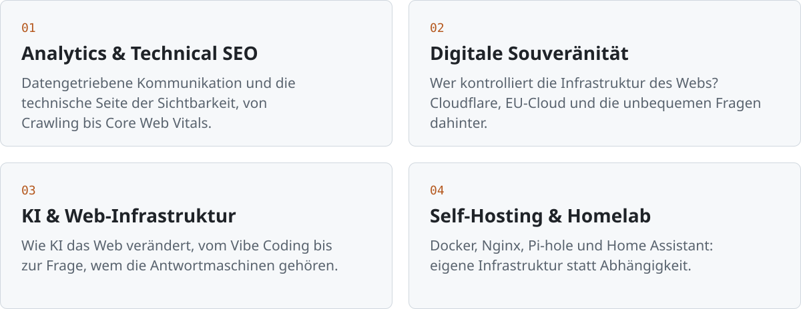
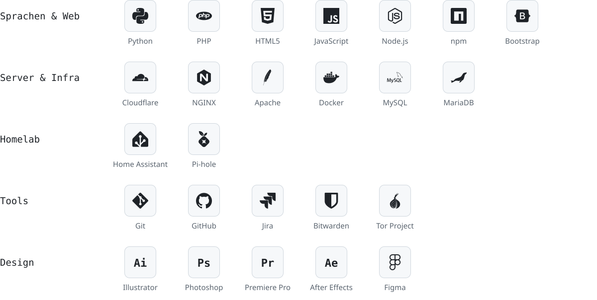
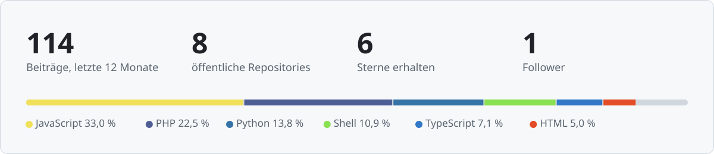

<picture>
  <source media="(prefers-color-scheme: dark)" srcset="https://raw.githubusercontent.com/PhilGabriel/PhilGabriel/main/assets/header-dark.svg" />
  
</picture>

## Über mich

Im Beruf analysiere ich Kommunikation: Corporate Strategy, Innovation, Technical SEO und Daten. Mich beschäftigt, wie digitale Souveränität, Anbieter wie Cloudflare und KI die Web-Infrastruktur verändern.

In meiner Freizeit baue ich kleine Werkzeuge für den Alltag. Dazu gehören Web-Tools, selbst gehostete Dienste und Design-Projekte. Sie sollen funktionieren, mehr nicht.

- **Aktuell:** Web-Projekte und Automatisierungen für mein Homelab
- **Am Lernen:** Infrastruktur-Automatisierung und saubere Frontend-Architektur
- **Erreichbar:** über die Links unter [Kontakt](#kontakt), Antwort meist innerhalb eines Tages

## Schwerpunkte

<picture>
  <source media="(prefers-color-scheme: dark)" srcset="https://raw.githubusercontent.com/PhilGabriel/PhilGabriel/main/assets/focus-dark.svg" />
  
</picture>

## Stack

<picture>
  <source media="(prefers-color-scheme: dark)" srcset="https://raw.githubusercontent.com/PhilGabriel/PhilGabriel/main/assets/stack-dark.svg" />
  
</picture>

## GitHub

<picture>
  <source media="(prefers-color-scheme: dark)" srcset="https://raw.githubusercontent.com/PhilGabriel/PhilGabriel/output/stats-dark.svg" />
  
</picture>

<picture>
  <source media="(prefers-color-scheme: dark)" srcset="https://raw.githubusercontent.com/PhilGabriel/PhilGabriel/output/github-contribution-grid-snake-dark.svg" />
  
</picture>

## Neueste Blog-Posts

Automatisch aktualisiert aus [philipp-gabriel.com/blog](https://philipp-gabriel.com/blog/):

<!-- BLOG-POST-LIST:START -->
- [Bot Yourself: Europas fehlende Antwort auf KI-Scraper und Bot-Traffic](https://philipp-gabriel.com/blog/europa-ki-scraper-antwort/)
- [Digitale Souveränität und KI – Wenn der Präsident den Stecker zieht](https://philipp-gabriel.com/blog/digitale-souveraenitaet-ki-stecker/)
- [Wie Cloudflare das Web neu schreibt – und was das für Sie bedeutet](https://philipp-gabriel.com/blog/wie-cloudflare-das-web-neu-schreibt/)
- [Cloudflare statt EU-Cloud: Das teure Versagen der digitalen Souveränität](https://philipp-gabriel.com/blog/cloudflare-statt-eu-cloud/)
- [Wie öffentliche APIs dem Gemeinwohl dienen: KVB-Daten und Ehrenfeld Kunstroute](https://philipp-gabriel.com/blog/oeffentliche-apis-gemeinwohl-kvb-ehrenfeld-kunstroute/)
<!-- BLOG-POST-LIST:END -->

## Kontakt

<a href="https://philipp-gabriel.com/"><picture><source media="(prefers-color-scheme: dark)" srcset="https://raw.githubusercontent.com/PhilGabriel/PhilGabriel/main/assets/btn-website-dark.svg" /></picture></a>
<a href="https://linkedin.com/in/philgabriel"><picture><source media="(prefers-color-scheme: dark)" srcset="https://raw.githubusercontent.com/PhilGabriel/PhilGabriel/main/assets/btn-linkedin-dark.svg" /></picture></a>
<a href="https://instagram.com/abenteueranalog"><picture><source media="(prefers-color-scheme: dark)" srcset="https://raw.githubusercontent.com/PhilGabriel/PhilGabriel/main/assets/btn-instagram-dark.svg" /></picture></a>
<a href="https://facebook.com/philgabriel.cgn"><picture><source media="(prefers-color-scheme: dark)" srcset="https://raw.githubusercontent.com/PhilGabriel/PhilGabriel/main/assets/btn-facebook-dark.svg" /></picture></a>

Unterstützen:

<a href="https://buymeacoffee.com/abenteueranalog"><picture><source media="(prefers-color-scheme: dark)" srcset="https://raw.githubusercontent.com/PhilGabriel/PhilGabriel/main/assets/btn-coffee-dark.svg" /></picture></a>
<a href="https://paypal.me/Abenteueranalog"><picture><source media="(prefers-color-scheme: dark)" srcset="https://raw.githubusercontent.com/PhilGabriel/PhilGabriel/main/assets/btn-paypal-dark.svg" /></picture></a>
